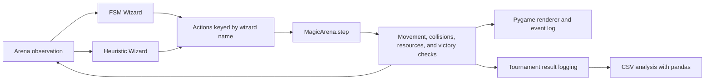

# Arcane Logic Arena

**A visual sandbox for exploring game AI through wizard duels.**

Arcane Logic Arena puts two decision-making strategies into the same 2D arena: a **finite-state machine (FSM)** and a **heuristic action-scoring agent**. Each wizard observes the battle, chooses an action, and balances attacking, evasion, positioning, and mana recovery.

Built with Python and Pygame, the project connects agent logic with an animated battle view, debug overlays, and CSV-based experiment analysis. Both agents use local, hand-written decision rules; no model service or API key is required.

[English](README.md) · [中文](README.zh-CN.md)

## Highlights

- **Two contrasting strategies:** explicit state transitions versus scoring candidate actions.
- **Resource-constrained combat:** fireballs and blinks consume mana, while meditation replenishes it.
- **Visual debugging:** inspect agent states, resource bars, threat indicators, and recent combat events.
- **Animated arena:** a gothic-inspired magic circle, projectile trails, blink effects, and floating damage numbers.
- **Shared simulation engine:** use the same combat mechanics in rendered or headless mode.
- **Extensible agent interface:** add a strategy by implementing `BaseWizard.act(observation)`.

## How a Duel Works

The arena contains two mages, each starting with **100 HP** and **50 MP**. At each simulation tick, both agents receive an observation and return an action. The engine processes the actions, advances projectiles, resolves collisions, updates resources, and checks for a defeated mage.

| Action | Parameters | Effect |
| --- | --- | --- |
| `FIREBALL` | `(target_x, target_y)` | Spend 20 MP to launch a projectile; a hit deals 10 damage |
| `BLINK` | `(target_x, target_y)` | Spend 15 MP to teleport; the engine clamps positions to arena bounds |
| `MEDITATE` | `None` | Recover 1 MP per tick while meditating, up to 50 MP |
| `WAIT` | `None` | Take no active action this tick |

The visual simulation targets 60 frames per second. Agent actions and resource updates are tick-based.

## The Agents

### Finite-State Machine Wizard

[`FSMWizard`](agents/fsm_wizard.py) organizes behavior into five states:

| State | Responsibility |
| --- | --- |
| `Idle` | Assess threats, mana, and distance before choosing the next behavior |
| `Attack` | Cast fireballs when the policy's mana and range conditions are met |
| `Evade` | Use blink to move away from detected threats when enough mana is available |
| `Retreat` | Handle retreat positioning or transition to recovery when mana is too low |
| `Recover` | Meditate until mana is restored, while checking for threats |

Each state is a separate class. Transitions depend on observed conditions, and the wizard tracks its previous HP to respond to damage.

### Heuristic Wizard

[`HeuristicWizard`](agents/heuristic_wizard.py) generates candidate actions and selects the one with the highest score. Its scoring rules consider:

- The distance to the opponent, with a preferred distance of 350 units.
- Available mana and the value of recovery.
- Nearby projectiles and the value of moving farther from them.
- Remaining health, which increases the priority of evasive actions.
- Whether a candidate blink improves positioning.

Blink candidates include randomly sampled nearby positions, so behavior can vary between runs.

## Architecture



`Mage` holds an in-game entity's position and resources. A wizard agent chooses actions for the entity with the same name. `MagicArena` owns the simulation, while `Renderer` presents its state. This separation lets agent policies evolve independently of the visual effects.

## Getting Started

Install Python 3 and run the following commands from a terminal:

```bash
git clone https://github.com/wangyux07-cmd/Arcane_Logic_Arena.git
cd Arcane_Logic_Arena
python -m venv .venv
```

Activate the virtual environment:

```powershell
# Windows PowerShell
.\.venv\Scripts\Activate.ps1
```

```bash
# macOS / Linux
source .venv/bin/activate
```

Install dependencies and launch the visual demo:

```bash
python -m pip install -r requirements.txt
python run_visual_test.py
```

The demo opens a **1280 × 720** Pygame window with `FSM_Merlin` facing `Heuristic_Morgana`. A graphical desktop is required for this mode.

| Control | Behavior |
| --- | --- |
| `D` | Toggle the debug overlay; enabled by default |
| Close the window | End the simulation |

The agents play autonomously; the viewer does not control either wizard.

## Running a Headless Simulation

For programmatic experiments, create an arena with `headless=True`. The following example runs up to 1,000 ticks without opening a window:

```python
from agents.fsm_wizard import FSMWizard
from agents.heuristic_wizard import HeuristicWizard
from core.engine import MagicArena, Mage

arena = MagicArena(800, 600, headless=True)
wizards = {
    "FSM": FSMWizard("FSM"),
    "Heuristic": HeuristicWizard("Heuristic"),
}

for name in wizards:
    arena.add_mage(Mage(name, 0, 0))  # The arena assigns starting positions.

for _ in range(1000):
    observation = arena.get_game_state()
    actions = {
        name: wizard.act(observation)
        for name, wizard in wizards.items()
    }
    state = arena.step(actions, wizards)
    if state["game_over"]:
        break

for mage in arena.mages:
    print(mage)
```

Run this code from the repository root so the project modules can be imported. Pygame remains a dependency because the engine imports its rendering module.

## Experiment Data

[`tournament/runner.py`](tournament/runner.py) contains the batch-match setup and CSV logging code. Recorded fields include agent types, match duration in ticks, and the HP and MP of both participants at the end of a match.

To summarize the included CSV file:

```bash
python analyze_results.py
```

The analysis script reads `logs/tournament_results.csv` and reports the distribution of recorded winners, their average remaining resources, and average duration grouped by recorded winner type.

## Adding Your Own Agent

Subclass `BaseWizard` and implement `act`. Here is a minimal agent that always waits:

```python
from agents.base_wizard import Action, BaseWizard


class WaitingWizard(BaseWizard):
    def act(self, observation: dict) -> Action:
        return Action("WAIT", None)
```

Register an instance in the `wizards` dictionary and add a `Mage` with the same name. Observations expose mages, projectiles, events, arena dimensions, and the game-over flag. Agents can also implement `get_debug_info(observation)` to provide data for the renderer's supported debug overlays.

## Project Layout

```text
Arcane_Logic_Arena/
├── agents/
│   ├── base_wizard.py       # Agent interface and Action type
│   ├── fsm_wizard.py        # State-based policy
│   └── heuristic_wizard.py  # Candidate generation and action scoring
├── core/
│   ├── engine.py           # Combat simulation and visual loop
│   └── renderer.py         # Arena, effects, UI, and debug overlays
├── tournament/
│   └── runner.py           # Batch-match setup and result logging
├── utils/
│   └── logger.py           # Bounded in-memory combat event log
├── logs/
│   └── tournament_results.csv
├── run_visual_test.py      # Visual demo entry point
├── analyze_results.py      # CSV summary analysis
└── requirements.txt        # pygame, pandas, tqdm
```
