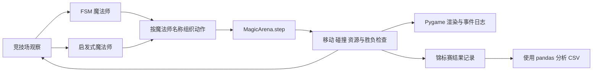

# Arcane Logic Arena

**通过魔法师对战，探索游戏 AI 决策的可视化实验场。**

Arcane Logic Arena 将两种决策策略放进同一个二维竞技场：**有限状态机（FSM）**和**启发式动作评分智能体**。每位魔法师观察战场、选择动作，并在攻击、闪避、站位和魔力恢复之间进行权衡。

项目使用 Python 和 Pygame，将智能体逻辑与动态战斗画面、调试叠加层以及基于 CSV 的实验分析相结合。两个智能体均使用本地编写的决策规则，无需模型服务或 API 密钥。

[English](README.md) · [中文](README.zh-CN.md)

## 项目特点

- **两种策略对照：** 显式状态切换与候选动作评分。
- **受资源约束的战斗：** 火球和闪现消耗魔力，冥想恢复魔力。
- **可视化调试：** 查看智能体状态、资源条、威胁提示和近期战斗事件。
- **动态竞技场：** 哥特风格魔法阵、弹道拖尾、闪现特效与飘字伤害。
- **共享仿真引擎：** 可视化模式和无窗口模式使用相同的战斗机制。
- **可扩展的智能体接口：** 实现 `BaseWizard.act(observation)` 即可添加新策略。

## 对战如何运行

竞技场包含两名魔法师，每人初始拥有 **100 点生命值（HP）**和 **50 点魔力值（MP）**。每个仿真步中，两个智能体接收观察并返回动作。引擎随后处理动作、推进弹道、检测碰撞、更新资源，并检查是否有魔法师被击败。

| 动作 | 参数 | 效果 |
| --- | --- | --- |
| `FIREBALL` | `(target_x, target_y)` | 消耗 20 MP 发射火球，命中造成 10 点伤害 |
| `BLINK` | `(target_x, target_y)` | 消耗 15 MP 传送，引擎将位置限制在竞技场边界内 |
| `MEDITATE` | `None` | 冥想期间每个仿真步恢复 1 MP，上限为 50 MP |
| `WAIT` | `None` | 本仿真步不采取主动动作 |

可视化仿真的目标帧率为每秒 60 帧。智能体动作和资源更新以仿真步为单位。

## 两种智能体

### 有限状态机魔法师

[`FSMWizard`](agents/fsm_wizard.py) 将行为组织为五种状态：

| 状态 | 职责 |
| --- | --- |
| `Idle`（待机） | 评估威胁、魔力和距离，决定下一种行为 |
| `Attack`（攻击） | 在满足策略设定的魔力与距离条件时发射火球 |
| `Evade`（闪避） | 魔力充足时，通过闪现远离检测到的威胁 |
| `Retreat`（撤退） | 处理撤退站位，或在魔力过低时转入恢复状态 |
| `Recover`（恢复） | 冥想恢复魔力，同时检查威胁 |

每个状态由独立的类实现。状态根据观察条件切换，魔法师还会记录上一轮的生命值，以响应受到的伤害。

### 启发式魔法师

[`HeuristicWizard`](agents/heuristic_wizard.py) 生成候选动作，并选择评分最高的动作。评分规则考虑：

- 与对手的距离，偏好的距离为 350 个坐标单位。
- 可用魔力以及恢复魔力的价值。
- 附近的弹道，以及远离弹道的价值。
- 剩余生命值；生命值越低，闪避动作的优先级越高。
- 候选闪现位置是否改善站位。

闪现候选位置包含随机采样的附近坐标，因此不同运行之间的行为可能不同。

## 系统架构



`Mage` 保存游戏实体的位置和资源。魔法师智能体为同名实体选择动作。`MagicArena` 管理仿真，`Renderer` 展示仿真状态。这样的分工让智能体策略和视觉效果可以分别演进。

## 快速开始

安装 Python 3，然后在终端执行：

```bash
git clone https://github.com/wangyux07-cmd/Arcane_Logic_Arena.git
cd Arcane_Logic_Arena
python -m venv .venv
```

激活虚拟环境：

```powershell
# Windows PowerShell
.\.venv\Scripts\Activate.ps1
```

```bash
# macOS / Linux
source .venv/bin/activate
```

安装依赖并启动可视化演示：

```bash
python -m pip install -r requirements.txt
python run_visual_test.py
```

演示会打开一个 **1280 × 720** 的 Pygame 窗口，由 `FSM_Merlin` 对战 `Heuristic_Morgana`。此模式需要图形桌面环境。

| 操作 | 效果 |
| --- | --- |
| `D` 键 | 切换调试叠加层，默认开启 |
| 关闭窗口 | 结束仿真 |

两个智能体自主对战，观看者不直接控制魔法师。

## 运行无窗口仿真

进行程序化实验时，可使用 `headless=True` 创建竞技场。以下示例不打开窗口，最多运行 1,000 个仿真步：

```python
from agents.fsm_wizard import FSMWizard
from agents.heuristic_wizard import HeuristicWizard
from core.engine import MagicArena, Mage

arena = MagicArena(800, 600, headless=True)
wizards = {
    "FSM": FSMWizard("FSM"),
    "Heuristic": HeuristicWizard("Heuristic"),
}

for name in wizards:
    arena.add_mage(Mage(name, 0, 0))  # 初始位置由竞技场分配。

for _ in range(1000):
    observation = arena.get_game_state()
    actions = {
        name: wizard.act(observation)
        for name, wizard in wizards.items()
    }
    state = arena.step(actions, wizards)
    if state["game_over"]:
        break

for mage in arena.mages:
    print(mage)
```

请从仓库根目录运行这段代码，以便导入项目模块。由于引擎会导入渲染模块，无窗口模式仍需安装 Pygame。

## 实验数据

[`tournament/runner.py`](tournament/runner.py) 包含批量对局设置和 CSV 记录代码。记录字段包含智能体类型、以仿真步计的对局时长，以及双方结束时的 HP 和 MP。

汇总仓库附带的 CSV 文件：

```bash
python analyze_results.py
```

分析脚本读取 `logs/tournament_results.csv`，报告记录中的获胜者分布、获胜者平均剩余资源，以及按记录的获胜者类型分组的平均对局时长。

## 添加自己的智能体

继承 `BaseWizard` 并实现 `act`。下面是一个始终等待的最小示例：

```python
from agents.base_wizard import Action, BaseWizard


class WaitingWizard(BaseWizard):
    def act(self, observation: dict) -> Action:
        return Action("WAIT", None)
```

在 `wizards` 字典中注册实例，并添加一个同名的 `Mage`。观察中包含魔法师、弹道、事件、竞技场尺寸和对局结束标记。智能体也可以实现 `get_debug_info(observation)`，为渲染器支持的调试叠加层提供数据。

## 项目结构

```text
Arcane_Logic_Arena/
├── agents/
│   ├── base_wizard.py       # 智能体接口与 Action 类型
│   ├── fsm_wizard.py        # 基于状态的策略
│   └── heuristic_wizard.py  # 候选动作生成与评分
├── core/
│   ├── engine.py           # 战斗仿真与可视化主循环
│   └── renderer.py         # 场景、特效、界面与调试叠加层
├── tournament/
│   └── runner.py           # 批量对局设置与结果记录
├── utils/
│   └── logger.py           # 容量有限的内存战斗事件日志
├── logs/
│   └── tournament_results.csv
├── run_visual_test.py      # 可视化演示入口
├── analyze_results.py      # CSV 汇总分析
└── requirements.txt        # pygame、pandas、tqdm
```
